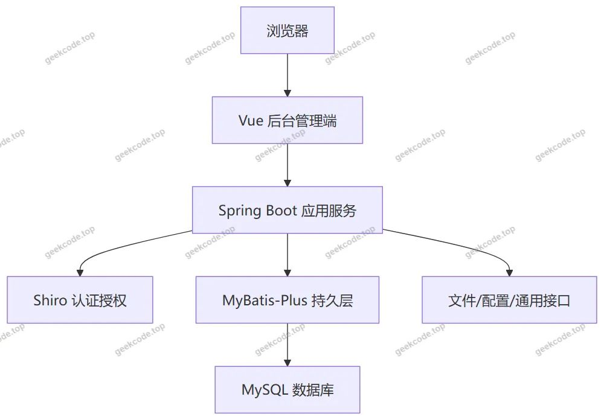
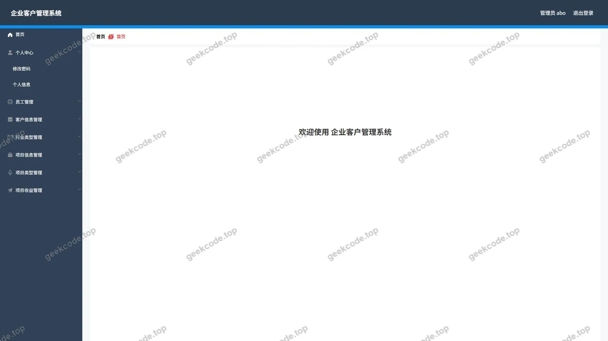
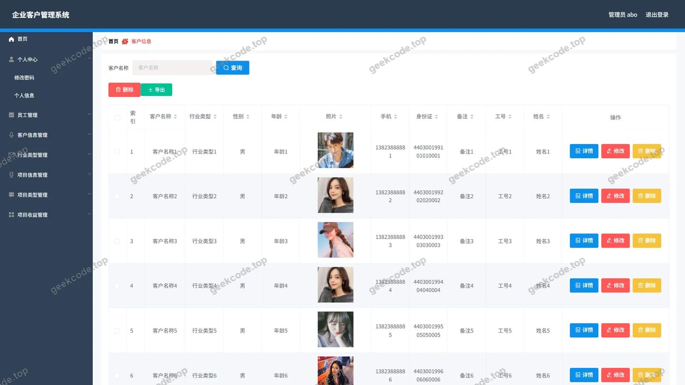
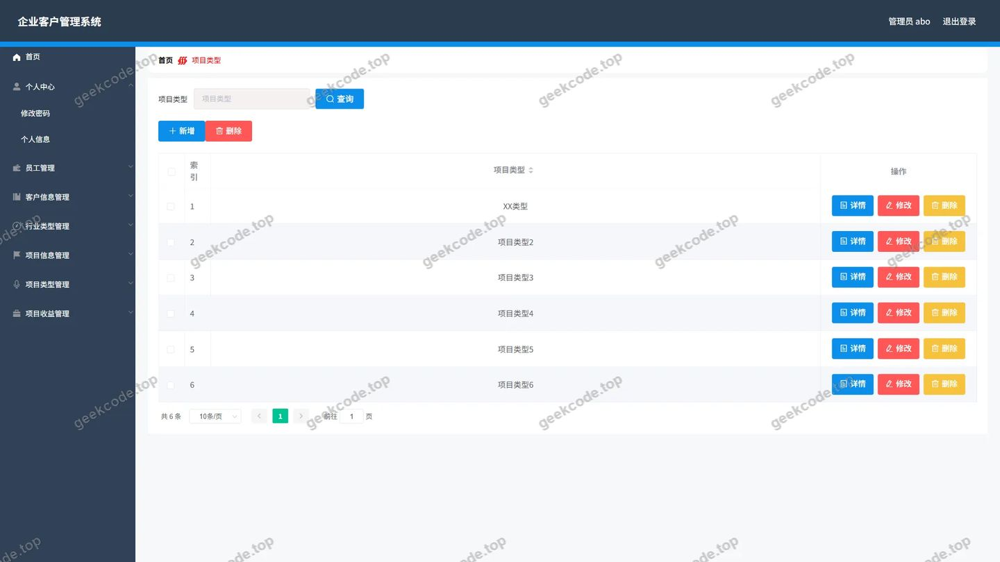
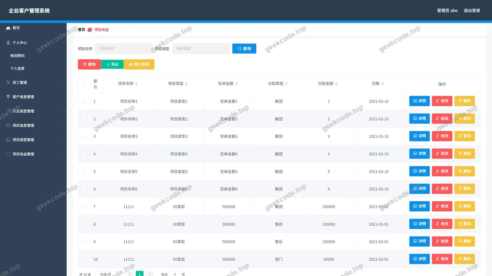
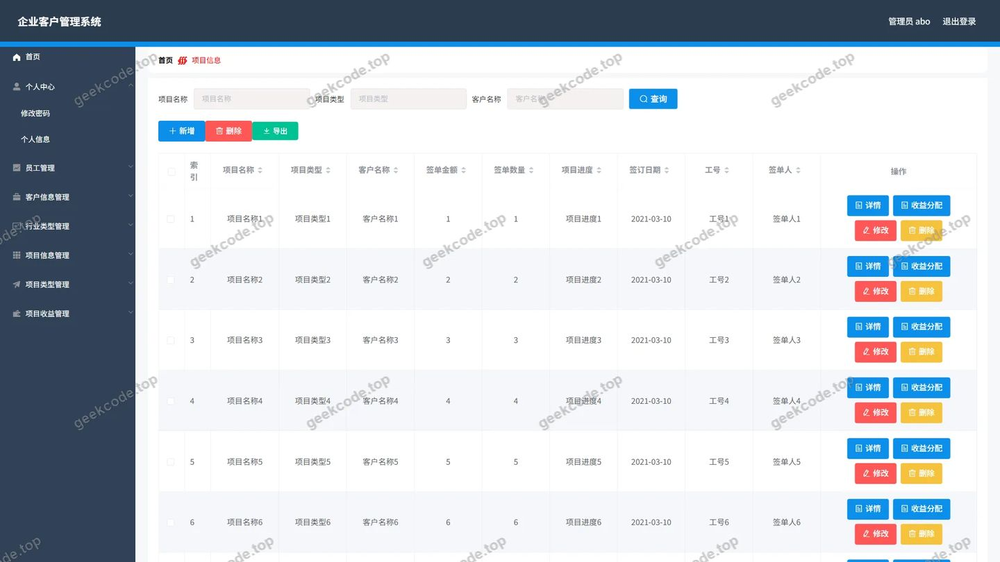
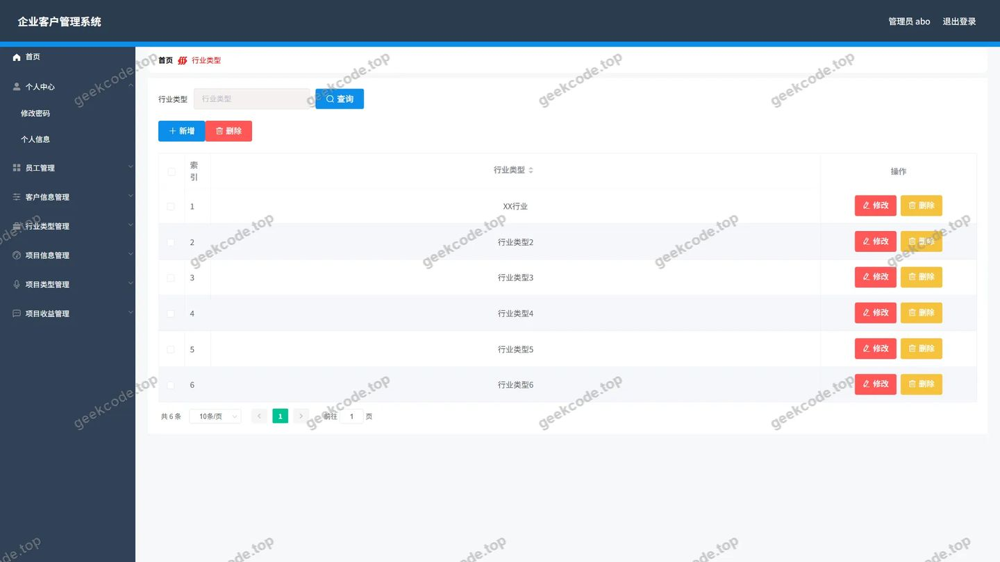
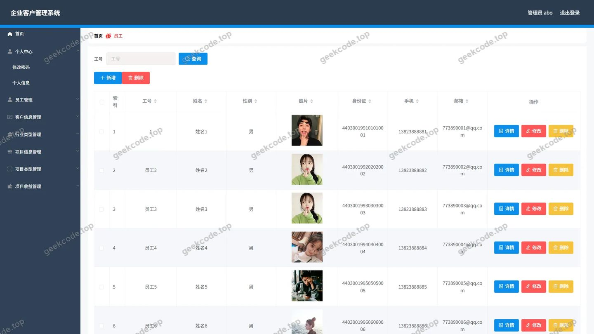

# 基于SpringBoot的企业客户管理系统的设计与实现

> 🎓 **计算机毕业设计 · 基于SpringBoot的企业客户管理系统的设计与实现**
>
> 本仓库只放**项目介绍 + 运行截图**（截图是站点带水印的原图，存在仓库 `images/` 里）。
>
> 👉 **完整可运行源码 / 数据库脚本 / 部署文档：[点我获取](https://geekcode.top/archives/%E5%9F%BA%E4%BA%8ESpringBoot%E7%9A%84%E4%BC%81%E4%B8%9A%E5%AE%A2%E6%88%B7%E7%AE%A1%E7%90%86%E7%B3%BB%E7%BB%9F%E7%9A%84%E8%AE%BE%E8%AE%A1%E4%B8%8E%E5%AE%9E%E7%8E%B0?utm_source=github)**
>
> 💬 咨询微信：**ir9372**　|　🌐 更多项目：[极客代码 geekcode.top](https://geekcode.top/?utm_source=github)
>
> 📌 项目详情页：<https://geekcode.top/archives/%E5%9F%BA%E4%BA%8ESpringBoot%E7%9A%84%E4%BC%81%E4%B8%9A%E5%AE%A2%E6%88%B7%E7%AE%A1%E7%90%86%E7%B3%BB%E7%BB%9F%E7%9A%84%E8%AE%BE%E8%AE%A1%E4%B8%8E%E5%AE%9E%E7%8E%B0?utm_source=github>

<table><td width="230" align="center"> <b>扫码加微信 ir9372</b></td><td valign="middle">📦 源码 = 项目介绍 + 全部运行截图 + 数据库 + 部署文档 👉 点上方任意截图，直接跳到 <b>极客代码 geekcode.top</b> 详情页</td></table>

---

<h1>基于SpringBoot的企业客户管理系统的设计与实现</h1>
<h2>项目概述</h2>

企业客户管理系统设计与实现面向企业内部客户资料、项目资料、项目收益、员工信息及相关基础数据的统一后台维护场景。系统不提供前台用户端，主要面向管理员使用，核心功能包括后台登录、后台首页、行业类型、项目类型、项目收益、客户信息、项目信息和员工管理。

技术架构方面，后端采用 Spring Boot 提供 Web 接口与业务服务能力，使用 MyBatis-Plus 完成数据访问与持久化，使用 Shiro 提供后台认证与访问控制支持；前端采用 Vue 构建后台管理界面，整体属于前后端一体化项目。数据库采用 MySQL 存储客户、项目、收益、员工及基础类型数据。

该项目适用于企业客户信息归档、项目基础数据维护、项目收益记录、员工资料管理以及行业类型、项目类型等基础数据集中维护场景，适合以后台管理为主要使用方式的企业内部信息化项目。

<h2>技术架构</h2>
<h3>前后端架构</h3>

系统采用前后端一体化架构。前端为 Vue 后台管理端，负责登录、首页、客户信息、项目信息、项目收益、员工、行业类型、项目类型等后台页面展示与交互；后端为 Spring Boot 应用，负责接口服务、业务处理、权限控制、数据校验与数据持久化。

后台路由包括：

<table>
<thead>
<tr>
<th>后台路由</th>
<th>对应模块</th>
</tr>
</thead>
<tbody><tr>
<td>/yuangong</td>
<td>员工管理</td>
</tr>
<tr>
<td>/xiangmuleixing</td>
<td>项目类型管理</td>
</tr>
<tr>
<td>/xingyeleixing</td>
<td>行业类型管理</td>
</tr>
<tr>
<td>/xiangmushouyi</td>
<td>项目收益管理</td>
</tr>
<tr>
<td>/kehuxinxi</td>
<td>客户信息管理</td>
</tr>
<tr>
<td>/xiangmuxinxi</td>
<td>项目信息管理</td>
</tr>
</tbody></table>

后端 Controller 包括：

<table>
<thead>
<tr>
<th>Controller</th>
<th>对应能力</th>
</tr>
</thead>
<tbody><tr>
<td>CommonController</td>
<td>通用接口</td>
</tr>
<tr>
<td>ConfigController</td>
<td>配置接口</td>
</tr>
<tr>
<td>FileController</td>
<td>文件接口</td>
</tr>
<tr>
<td>KehuxinxiController</td>
<td>客户信息接口</td>
</tr>
<tr>
<td>UserController</td>
<td>用户接口</td>
</tr>
<tr>
<td>XiangmuleixingController</td>
<td>项目类型接口</td>
</tr>
<tr>
<td>XiangmushouyiController</td>
<td>项目收益接口</td>
</tr>
<tr>
<td>XiangmuxinxiController</td>
<td>项目信息接口</td>
</tr>
<tr>
<td>XingyeleixingController</td>
<td>行业类型接口</td>
</tr>
<tr>
<td>YuangongController</td>
<td>员工接口</td>
</tr>
</tbody></table>

系统架构关系如下：

<h3>数据库设计要点</h3>

数据库围绕后台管理模块设计，主要数据对象包括客户信息、项目信息、项目收益、员工、行业类型、项目类型。客户信息用于记录企业客户基础资料，项目信息用于记录项目基础资料，项目收益用于记录项目相关收益数据，员工用于记录企业内部人员信息，行业类型与项目类型用于维护基础分类数据。

数据访问层采用 MyBatis-Plus，实体与数据库表之间通过映射完成持久化操作。核心数据之间可形成基础业务关联，例如项目信息可关联客户信息，项目收益可关联项目信息，客户信息或项目信息可关联行业类型、项目类型等基础数据。现有上下文未提供具体表字段，因此字段级设计以实际数据库表结构为准。

<h3>核心技术选型理由</h3>
<ul>
<li>Spring Boot：用于构建后端 Web 服务，提供接口开发、依赖管理和应用运行能力。</li>
<li>MyBatis-Plus：用于数据持久层开发，支持数据库表与实体映射，适合后台管理系统的增删改查场景。</li>
<li>Shiro：用于后台登录认证与访问控制，保障后台管理功能的安全访问。</li>
<li>MySQL：作为关系型数据库，存储客户、项目、收益、员工及基础类型数据。</li>
<li>Vue：用于构建后台管理界面，满足管理员在浏览器端完成数据维护。</li>
<li>spring-boot-starter-web：提供 Web 接口服务能力。</li>
<li>spring-boot-starter-jdbc、mysql-connector-java：提供 JDBC 与 MySQL 数据连接支持。</li>
<li>validation-api：用于参数校验与数据约束。</li>
<li>commons-lang3：用于通用工具处理。</li>
<li>protobuf-java：作为项目依赖引入，用于相关数据处理或序列化能力。</li>
</ul>
<h2>功能模块</h2>
<h3>前台用户端</h3>

根据项目信息，系统无前台用户端，因此不存在面向普通前台用户的功能模块。

<h3>后台管理端</h3>
<table>
<thead>
<tr>
<th>功能模块</th>
<th>功能描述</th>
</tr>
</thead>
<tbody><tr>
<td>后台登录</td>
<td>管理员进入后台管理系统的认证入口。</td>
</tr>
<tr>
<td>后台首页</td>
<td>管理员登录后的主要操作入口页面。</td>
</tr>
<tr>
<td>行业类型</td>
<td>维护企业客户或项目相关业务中的行业类型基础数据。</td>
</tr>
<tr>
<td>项目类型</td>
<td>维护项目分类、项目类型等基础数据。</td>
</tr>
<tr>
<td>项目收益</td>
<td>维护项目收益记录及相关数据。</td>
</tr>
<tr>
<td>客户信息</td>
<td>维护企业客户基础资料。</td>
</tr>
<tr>
<td>项目信息</td>
<td>维护项目基础资料。</td>
</tr>
<tr>
<td>员工</td>
<td>维护员工信息数据。</td>
</tr>
<tr>
<td>文件管理</td>
<td>通过 FileController 提供文件相关接口能力。</td>
</tr>
<tr>
<td>配置管理</td>
<td>通过 ConfigController 提供配置相关接口能力。</td>
</tr>
<tr>
<td>通用接口</td>
<td>通过 CommonController 提供通用数据接口能力。</td>
</tr>
</tbody></table>

后台管理端整体以数据维护为主，覆盖客户、项目、收益、员工、行业类型、项目类型等企业客户管理相关基础业务对象。

<h2>用户角色与权限</h2>

根据现有项目信息与截图，系统仅明确存在后台管理员角色，未出现前台用户、个人中心或其他角色入口。

<table>
<thead>
<tr>
<th>角色</th>
<th>可访问功能模块</th>
</tr>
</thead>
<tbody><tr>
<td>管理员</td>
<td>后台登录、后台首页、行业类型、项目类型、项目收益、客户信息、项目信息、员工、文件接口、配置接口、通用接口</td>
</tr>
</tbody></table>

管理员是系统的主要使用者，负责进入后台管理界面，并对客户信息、项目信息、项目收益、员工信息、行业类型、项目类型等数据进行维护。Shiro 为后台登录和访问控制提供安全支持。

<h2>项目特色与创新点</h2>
<ul>
<li>面向企业内部管理场景：系统不提供前台用户端，聚焦后台管理端的数据维护与业务信息管理，适合企业内部客户管理信息化建设。</li>
<li>模块化后台管理：围绕客户信息、项目信息、项目收益、员工、行业类型、项目类型形成独立管理模块，便于分类维护数据。</li>
<li>前后端一体化：采用 Vue 后台管理端与 Spring Boot 后端服务结合，便于统一开发、部署和维护。</li>
<li>持久层开发效率较高：使用 MyBatis-Plus 支持数据访问与常见后台管理操作，降低重复性持久层开发成本。</li>
<li>后台访问安全：引入 Shiro 提供认证与访问控制能力，保障后台管理功能的安全使用。</li>
<li>基础数据与业务数据分离：行业类型、项目类型作为基础数据模块，客户信息、项目信息、项目收益作为业务数据模块，有利于后续数据维护与统计分析。</li>
</ul>

项目解决的核心问题是企业客户资料、项目资料、收益记录和员工信息分散管理的问题，通过统一后台管理入口实现基础数据和业务数据的集中维护。

<h2>部署环境</h2>

系统运行需要以下软件环境：

<table>
<thead>
<tr>
<th>环境项</th>
<th>用途</th>
</tr>
</thead>
<tbody><tr>
<td>JDK</td>
<td>运行 Spring Boot 后端应用</td>
</tr>
<tr>
<td>MySQL</td>
<td>存储客户信息、项目信息、项目收益、员工、行业类型、项目类型等数据</td>
</tr>
<tr>
<td>Spring Boot 运行环境</td>
<td>提供后端接口服务、业务处理与访问控制能力</td>
</tr>
<tr>
<td>Vue 前端构建或运行环境</td>
<td>用于后台管理端页面构建与展示</td>
</tr>
<tr>
<td>Node.js</td>
<td>如采用源码方式构建 Vue 后台管理端，则需要 Node.js 环境</td>
</tr>
<tr>
<td>Maven 或项目构建工具</td>
<td>用于后端依赖管理与项目构建</td>
</tr>
</tbody></table>

现有上下文未提供具体版本号。部署时需根据实际工程配置确定 JDK、MySQL、Node.js 等组件的版本要求，并配置数据库连接、服务端口、文件路径和后台访问地址。

<h2>五、技术特性</h2>
<ul>
<li>前后端集成部署，前端资源打包至后端 static 目录</li>
<li>使用 MyBatis-Plus 简化数据访问层开发</li>
<li>集成 Shiro 权限框架实现角色权限控制</li>
</ul>
<h2>六、功能模块截图</h2>
<h3>后台管理端</h3>
<h4>后台首页</h4>

<h4>后台-客户信息</h4>

<h4>后台-登录</h4>

<h4>后台-项目类型</h4>

<h4>后台-项目收益</h4>

<h4>后台-项目信息</h4>

<h4>后台-行业类型</h4>

<h4>后台-员工</h4>

---

## 获取完整源码

| 项目 | 说明 |
| --- | --- |
| 项目名 | 基于SpringBoot的企业客户管理系统的设计与实现 |
| 运行截图 | 本文 9 张（站点带水印原图，仓库 `images/` 目录） |
| 完整源码 | [https://geekcode.top/archives/%E5%9F%BA%E4%BA%8ESpringBoot%E7%9A%84%E4%BC%81%E4%B8%9A%E5%AE%A2%E6%88%B7%E7%AE%A1%E7%90%86%E7%B3%BB%E7%BB%9F%E7%9A%84%E8%AE%BE%E8%AE%A1%E4%B8%8E%E5%AE%9E%E7%8E%B0?utm_source=github](https://geekcode.top/archives/%E5%9F%BA%E4%BA%8ESpringBoot%E7%9A%84%E4%BC%81%E4%B8%9A%E5%AE%A2%E6%88%B7%E7%AE%A1%E7%90%86%E7%B3%BB%E7%BB%9F%E7%9A%84%E8%AE%BE%E8%AE%A1%E4%B8%8E%E5%AE%9E%E7%8E%B0?utm_source=github) |
| 咨询微信 | **ir9372**（备注：jingpin-yuanma） |
| 更多项目 | [极客代码 geekcode.top](https://geekcode.top/?utm_source=github) |

> 需要源码、部署、改配置、跑不起来等问题，加微信 ir9372 沟通，说明项目名即可。
